<p align="center">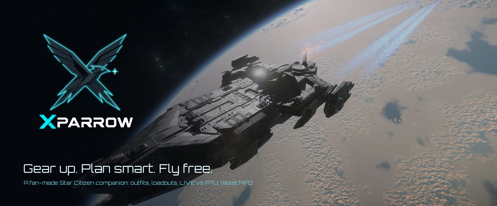</p>

# Xparrow 1.1.27

**Gear up. Plan smart. Fly free.**

[](https://xparrow-lite.pages.dev) [](https://github.com/BlackXparrow/xparrow/releases/latest) [](https://ko-fi.com/blackxparrow)

Xparrow is a fan-made desktop companion for Star Citizen. It shows outfits, weapons, ship loadouts, LIVE vs PTU changes, your session plan and a tablet MFD. Everything it shows is read from **your own** Star Citizen install on your PC.

Want to try it first? **[Xparrow Lite](https://xparrow-lite.pages.dev)** runs in your browser, including on your phone — no download.


> Promo video (62 s): [xparrow_promo.mp4](https://github.com/BlackXparrow/xparrow/releases/download/v1.1.6/xparrow_promo.mp4): outfits, weapons with attachments, ships in 3D, LIVE vs PTU, session plan, damage viewer, live location on the map and the tablet MFD.

## ✨ Xparrow Lite vs Xparrow App

<p align="center">
  <a href="https://xparrow-lite.pages.dev"></a>
  &nbsp;
  <a href="https://github.com/BlackXparrow/xparrow/releases/latest"></a>
</p>

**Xparrow Lite** is the free browser version: no install, and it works on your phone. **Xparrow** (the Windows app) is the full desktop companion, with 3D, the in-game overlay, the tablet MFD and auto-update.

| Feature | Lite (browser)<br><sub>No install. Works on your phone.</sub> | App (Windows)<br><sub>Full desktop app: overlay, 3D, auto-update.</sub> |
|:--------|:----------------------------------------------------------:|:---------------------------------------------------------------------:|
| | **Getting started** | |
| **Runs in your browser** — nothing to install | ✅ | ➖ Windows app (installer or portable) |
| **Works on a phone** — browse outfits, ships, the map and more | ✅ | ➖ the phone is used as the tablet MFD |
| **Always current** | ✅ the website is already the latest | ✅ built-in auto-update from Releases |
| | **Outfits & 3D** | |
| **Outfit try-on** — armour and clothes on a character | ✅ 2D paper doll (front/back, male/female) | ✅ 3D turntable, colour variants, hologram |
| **Outfit Compare** | ✅ side-by-side stats | ✅ stats + side-by-side 3D |
| **Item details** — craft it, loot it, buy it, share a link | ✅ | ✅ |
| **3D models** — outfits, weapons and ships | ➖ pictures only (never upscaled) | ✅ 3D views and holograms |
| **Load 3D from your game files** | ➖ | ✅ on demand from your own install |
| | **Ships** | |
| **Ship catalog and loadout** — guns, components, totals, where to buy | ✅ pictures (¾, top, underside) and stats | ✅ 3D loadout, drag-and-drop parts |
| **Ship Compare (LIVE vs PTU)** — buffs, nerfs and new items | ✅ | ✅ |
| **Fleet hangar planner** — measured bays | ➖ | ✅ |
| | **Weapons** | |
| **Weapons catalog and stats** | ✅ pictures and real numbers | ✅ 3D weapons, attachments and presets |
| **Attachments** | ✅ listed, with stats vs the gun | ✅ drag onto the gun; the stats and the model update |
| **Weapons LIVE vs PTU** | ✅ | ✅ including a holographic PTU gun; drop an attachment on one and it is fitted on both |
| **Damage viewer** | ➖ | ✅ see hits per body part, health values and armour resistance |
| | **Map & Exploration** | |
| **Star map** — Stanton, Pyro and Nyx | ✅ | ✅ |
| **Live position from Game.log** | ✅ pick Game.log once in Chrome or Edge; follows while the tab is open | ✅ automatic from your install |
| **Locate** — paste a `/showlocation` from game chat | ✅ | ✅ |
| **Hidden locations** — wrecks, derelicts, caves, easter eggs | ✅ | ✅ |
| **Quantum routes** — destination, ship or drive, QT time | ✅ | ✅ |
| **Loot nearby** — pick gear and rarity, set a radius, see the closest drops | ✅ | ✅ |
| | **Planning & data** | |
| **Blueprints & crafting** — filters, how to get it, craft simulator | ✅ | ✅ |
| **Wikelo Emporium** | ✅ | ✅ |
| **Black Market** — contraband, prices, Executive Hangar timer | ✅ | ✅ |
| **Session plan** — today's loot list, map guidance and progress | ✅ saved in this browser (syncs if you link the app) | ✅ plus Backup & Restore |
| **Faction standings** — ranks and the game's own icons | ✅ | ✅ |
| **Mission & blueprint tracker** — follows your active contract from Game.log | ➖ | ✅ payout, standing and blueprint drops, with one-click + Plan |
| **Ask SC** — lore, items, trade prices, PTU changes | ➖ | ✅ answers from your local data, offline, no account |
| | **In-game Overlay & MFD** | |
| **In-game overlay** — always-on-top while you play | ➖ | ✅ |
| **Tablet MFD** — power, weapons, shields and fire mode, using your game binds | ➖ preview in Settings; ship control needs the app | ✅ full tablet, QR pairing, per-ship look and pips |
| **Link Lite to the app** — live map, plan sync, MFD through the app | ✅ 6-character code in Settings | ✅ Settings → Link Xparrow Lite |
| | **Data & Updates** | |
| **Settings & Keybinding** — binds, curves and graphics, LIVE and PTU | ➖ | ✅ read from your game files |
| **Joystick flight tester** — holographic ship, your binds and curves | ➖ | ✅ canyon, meteor dodge, orbit and maneuver drills |
| **Scan joysticks / device setup** | ➖ | ✅ |
| **Backup & Restore** — plan, mission tracker and settings | ➖ | ✅ |
| **Reads your own game files locally** — nothing is uploaded | ➖ optional Game.log pick or app link only | ✅ outfits, 3D, binds and data stay on your PC |

**Want everything?** [Get the full app](https://github.com/BlackXparrow/xparrow/releases/latest) — it's free.

## Features

| | |
|---|---|
| **Outfits** | 3D armor and clothing viewer with turntable, colour variants and stats. |
| **Weapons** | FPS weapons, attachments and presets, with real numbers from the game data. Drag attachments straight onto the gun and watch the stats change. In Compare, drop one on the LIVE or PTU gun and it's fitted on both. |
| **Ship Loadout** | Components and guns per slot, swap and compare, and where to buy them. Drag parts onto the ship, or a fitted part off it to remove it. Ships without 3D keep full stats ("3D coming soon"). |
| **Ship Compare (LIVE vs PTU)** | Buffs, nerfs and new items between your LIVE and PTU builds, with a link to the official patch notes. |
| **Fleet** | Hangar planner with measured bays. |
| **Exploration** | Star map and live position. Find hidden locations (wrecks, derelicts, caves, easter eggs) with a route to get there. Loot Finder: pick the gear and rarity you want, set a radius, and see every spot nearby that can drop it, closest first. Press *Locate* to realign the map with where you are in game. |
| **Mission & Blueprint tracker** | Follows your active contract from `Game.log`: payout, faction standing and the blueprints it can drop, with one-click *+ Plan*. |
| **Ask SC** | A built-in Star Citizen Q&A: lore, items, trade prices, PTU changes. It answers from your own local data with sources, works offline and needs no account. |
| **Session Plan** | Today's loot list, map guidance and progress. |
| **Blueprints & Crafting, Wikelo, Black Market** | Recipes, contracts, contraband and where to find things. |
| **Overlay** | A small always-on-top panel for use while playing. |
| **Tablet MFD** | Power, weapons, shields and fire mode from a tablet or phone on your network. Every ship you board changes the MFD: the maker's look, its logo and that ship's power pip setup. It uses the binds you set in the game. |
| **Settings & Keybinding** | Your binds, curves and graphics settings, read from the game files. LIVE and PTU each have their own binds. |
| **Backup & Restore** | Save your session plan, mission tracker and Xparrow settings to a folder you pick, and restore them later or on another PC. |
| **Joystick flight tester** | Test your sticks and fly a holographic ship with your own binds and curves: a low-flight canyon, meteor dodge, orbit and maneuver drills. |
| **On-demand 3D** | Ships that have no 3D model yet can load it from your game files: *Load 3D from my game files* on the ship, or *Load all missing 3D* in Settings. |

<p align="center">
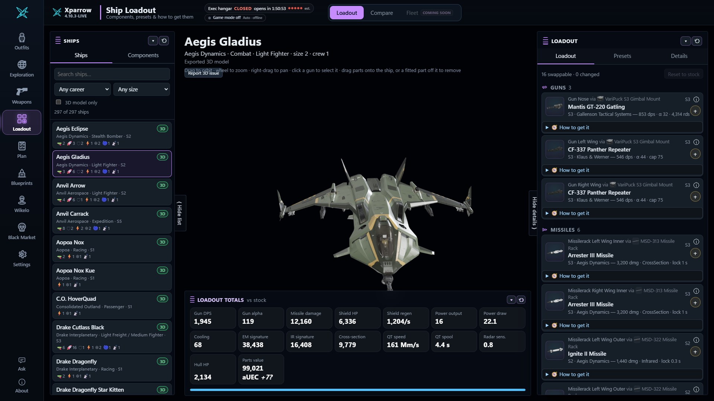 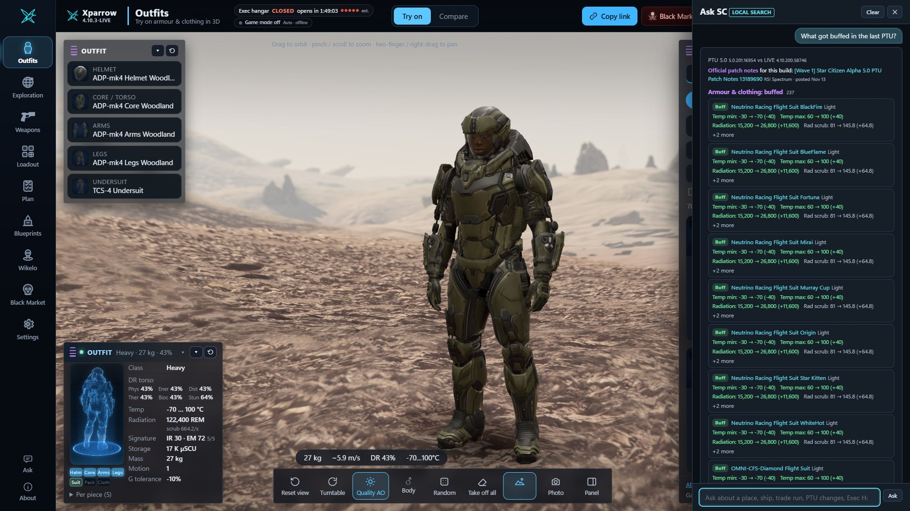
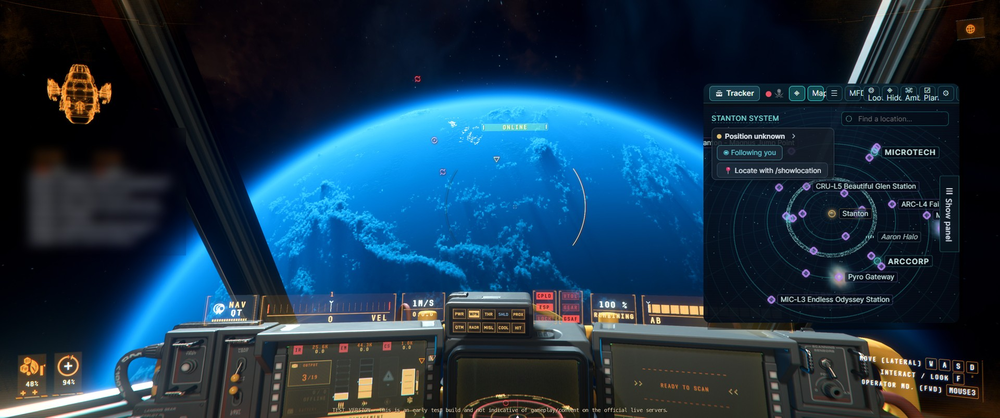 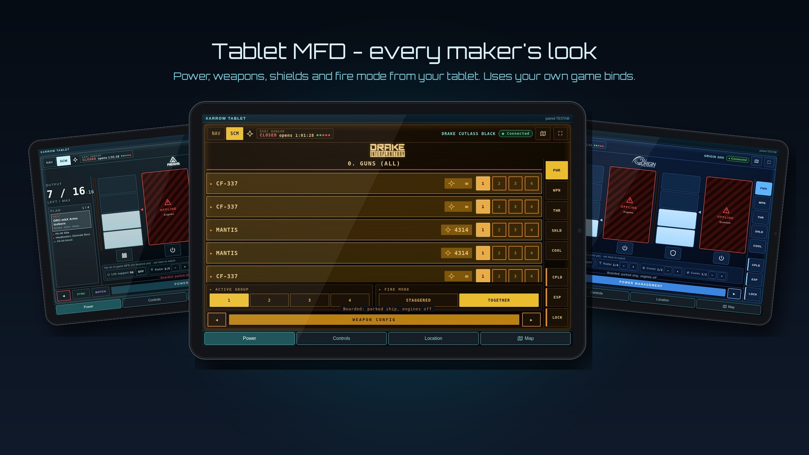
</p>

## Gallery

<table>
<tr><td width="33%" align="center">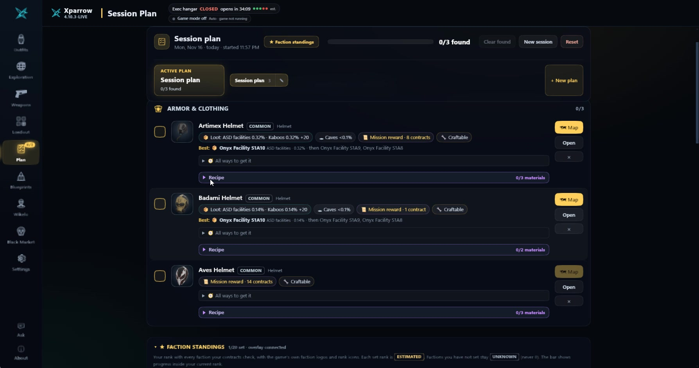<br><sub>Session Plan: what to get and where</sub></td><td width="33%" align="center">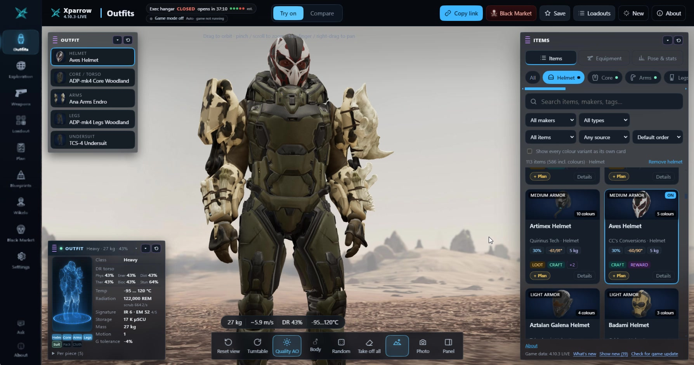<br><sub>Outfits: armor and helmets in 3D</sub></td><td width="33%" align="center">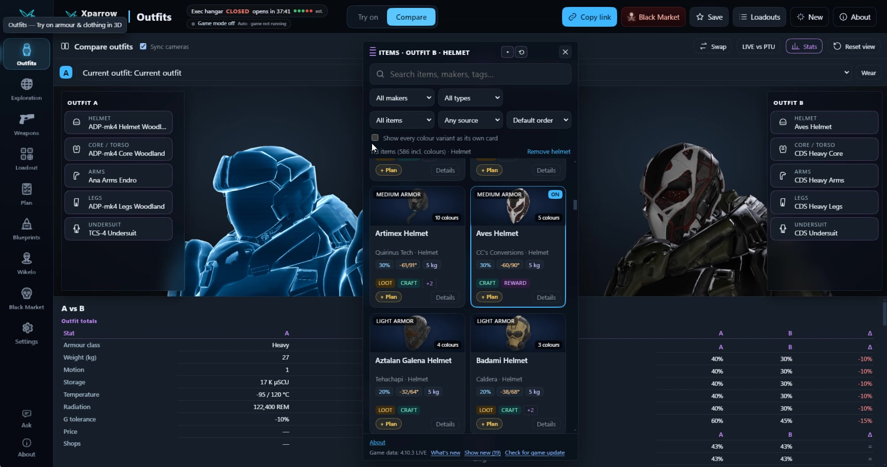<br><sub>Outfit Compare</sub></td></tr>
<tr><td width="33%" align="center">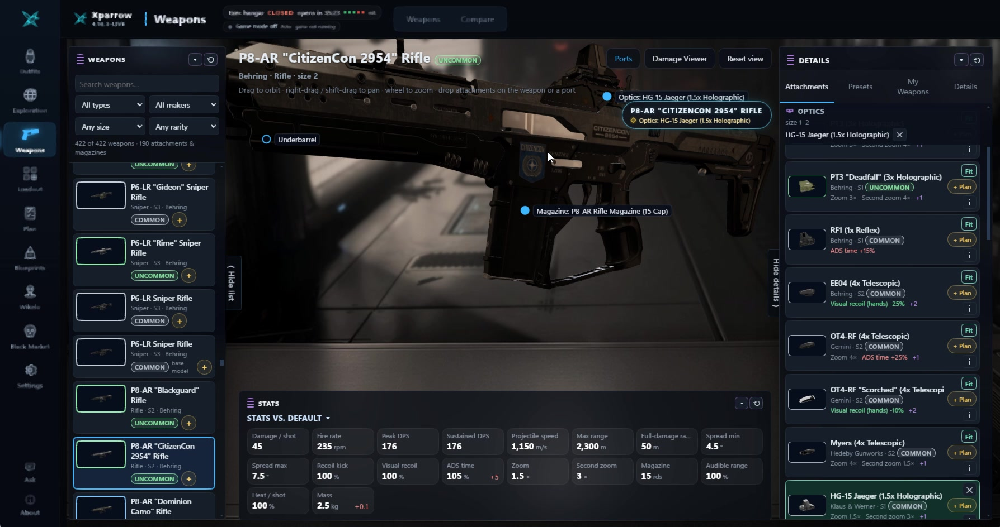<br><sub>Weapons: loadout with attachments</sub></td><td width="33%" align="center">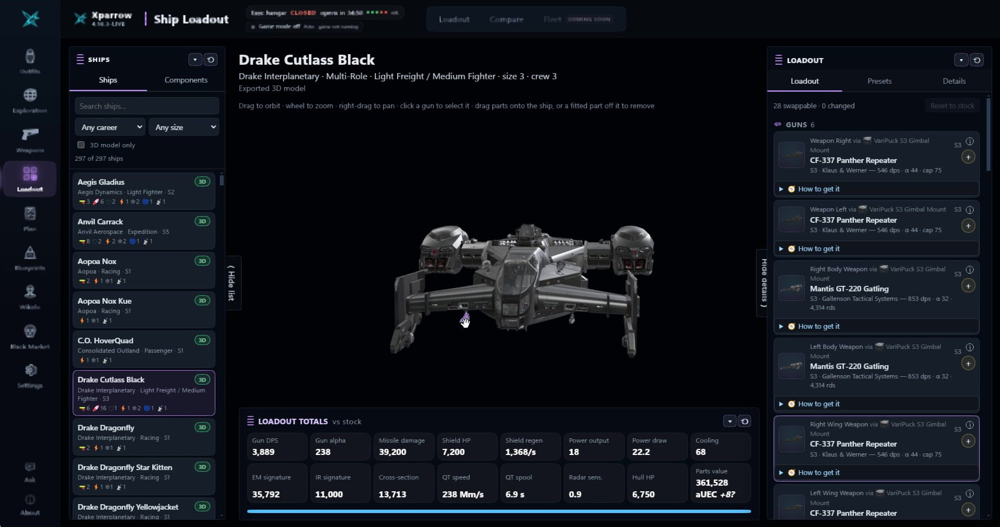<br><sub>Ship Loadout in 3D</sub></td><td width="33%" align="center">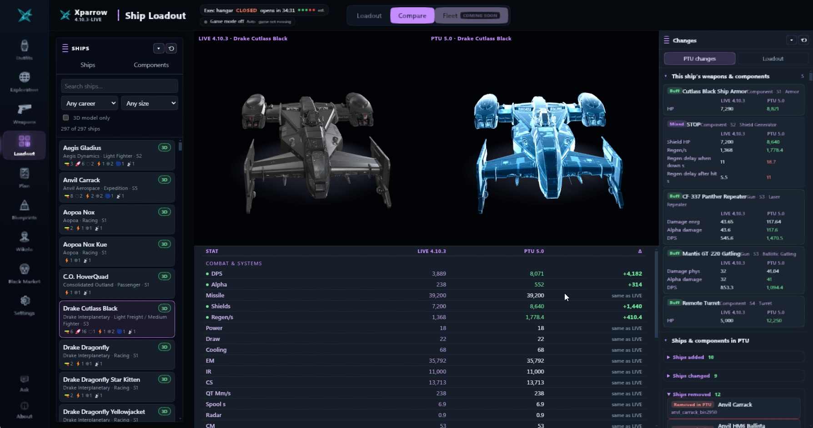<br><sub>Ship Compare: LIVE vs PTU</sub></td></tr>
<tr><td width="33%" align="center">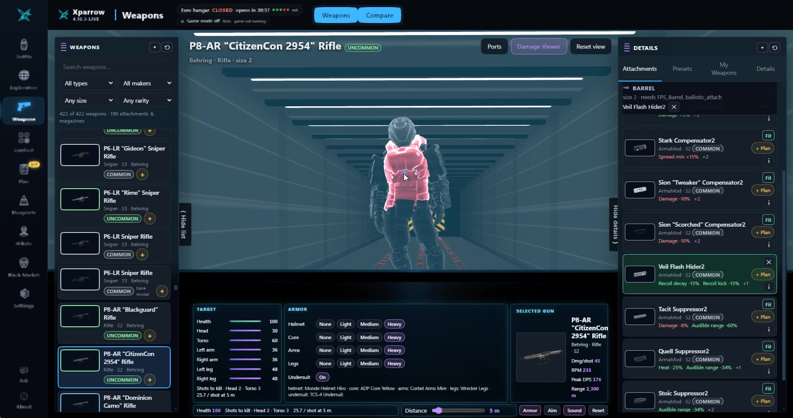<br><sub>Damage viewer</sub></td><td width="33%" align="center">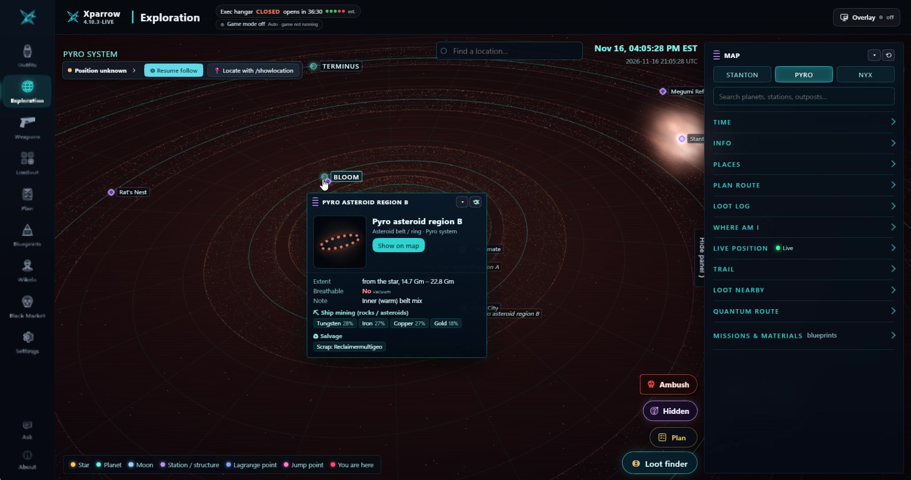<br><sub>Map: planet info</sub></td><td width="33%" align="center">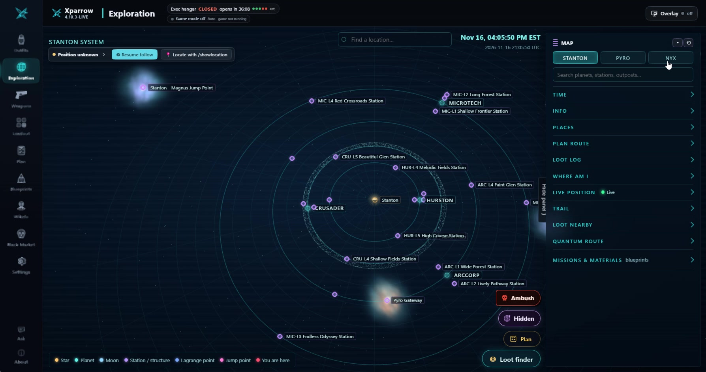<br><sub>Map: Stanton</sub></td></tr>
<tr><td width="33%" align="center">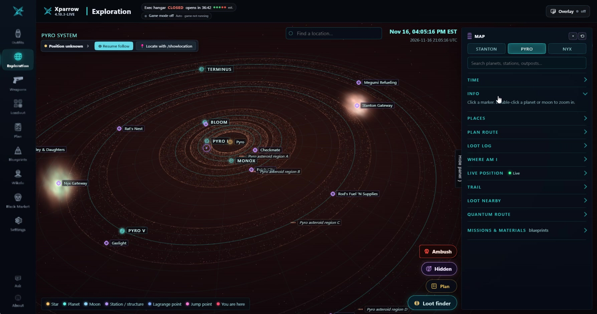<br><sub>Map: Pyro</sub></td><td width="33%" align="center">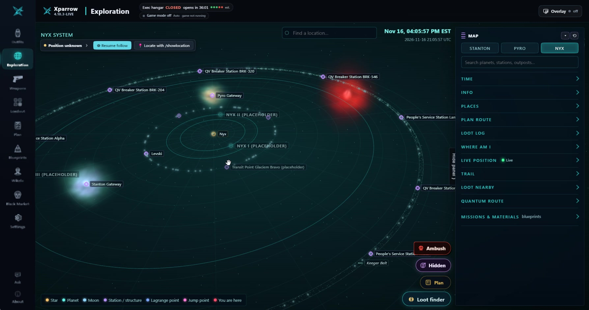<br><sub>Map: Nyx</sub></td><td width="33%" align="center">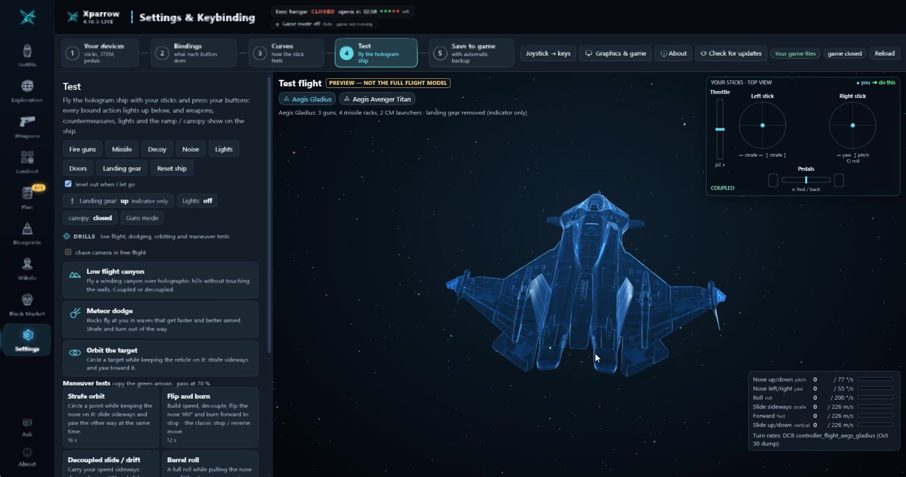<br><sub>Settings & Keybinding: flight curves</sub></td></tr>
<tr><td width="33%" align="center">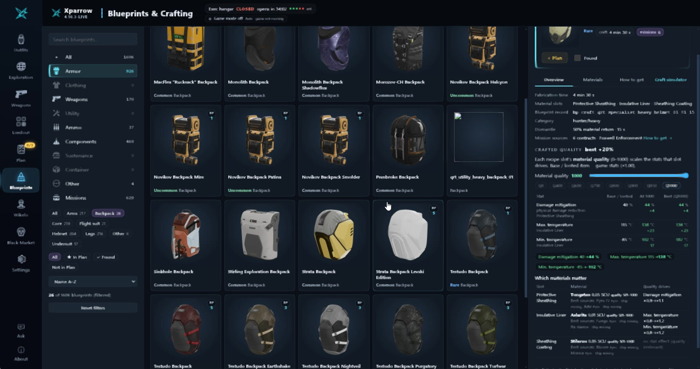<br><sub>Blueprints & Crafting</sub></td><td width="33%" align="center">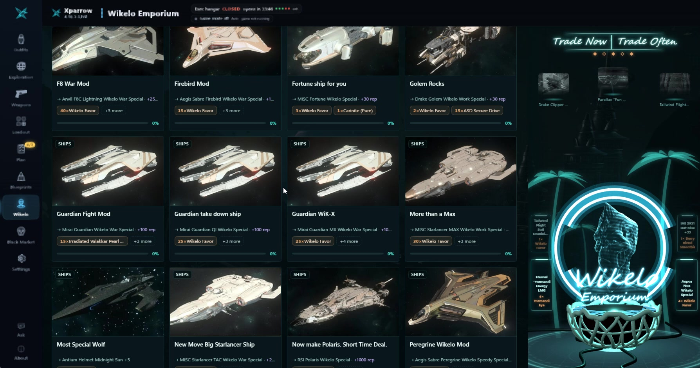<br><sub>Wikelo Emporium</sub></td><td width="33%" align="center">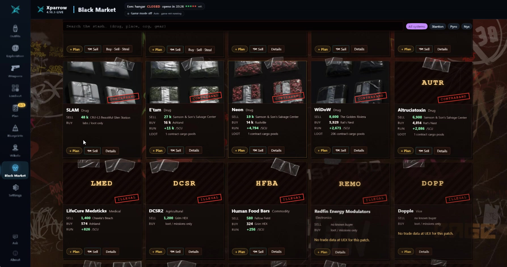<br><sub>Black Market</sub></td></tr>
</table>

## Download

From **Releases** (v1.1.27):

- `Xparrow-Setup-1.1.27.exe`: installer (Start menu shortcut, uninstaller). **Recommended:** it updates itself.
- `Xparrow-Portable-1.1.27.exe`: portable. Run it from any folder. Nothing gets installed, and it does not update itself.
- `latest.yml` and `Xparrow-Setup-1.1.27.exe.blockmap`: used by the built-in auto-update. You don't need to download them.
- `SHA256SUMS.txt`: checksums. Check a download with `Get-FileHash .\Xparrow-Setup-1.1.27.exe` in PowerShell and compare.

SHA256 (v1.1.27):

```
e1a78ddde417fa0a1bd0eed02e08d726198c9670f83d0bda0a48de42247a5ea9  Xparrow-Setup-1.1.27.exe
7b30f23e16c2664f89577cb186a721b96a3937311403d0c2aaba2ce6374eeb8f  Xparrow-Portable-1.1.27.exe
```

**Virus scan:** [VirusTotal scan of Xparrow-Setup-1.1.27.exe](https://www.virustotal.com/gui/file/e1a78ddde417fa0a1bd0eed02e08d726198c9670f83d0bda0a48de42247a5ea9): 0 detections (checked Nov 26, 2026). Each new release is scanned too.

**Windows SmartScreen:** Xparrow isn't code-signed (signing certificates are expensive for a free fan project), so Windows may show *"Windows protected your PC"*. Click **More info > Run anyway**. Compare the checksum above first if you want to be sure the file is the real one.

### Updates

- **From 1.1.14 on, updates install when it is safe.** Xparrow checks GitHub Releases when it starts and every two hours, and downloads a new version quietly. It installs after the app has been idle for about 10 minutes and Star Citizen is not running, or the next time you open Xparrow. A small **Update ready, restart now** button in the header lets you install immediately. It will not interrupt you mid-game and will not close Star Citizen. Your data, settings and session plan are kept.
- **From 1.1.7 through 1.1.13:** those versions also update themselves, but they install the next time you quit Xparrow. After you reach 1.1.14, the safer install above takes over.
- **Coming from 1.1.6 or older:** those versions can't update themselves. Download `Xparrow-Setup-1.1.27.exe` once and install it over your current version. Your data folder is kept and nothing has to be rebuilt. After that, updates are automatic.
- **Weapons, Ship Loadout, Blueprints or Black Market said "failed to load" (404) on 1.1.6:** that version didn't include those data files. Install 1.1.27 and the pages load. No manual data pack is needed.

## First-run setup

1. Start Xparrow. The setup window finds your Star Citizen install (for example `C:\Program Files\Roberts Space Industries\StarCitizen\LIVE`). Pick it or browse to it. A PTU install in the same StarCitizen folder is linked too, for the LIVE vs PTU compare.
2. Pick a drive for Xparrow's data. It needs about **13 GB** when done and up to about **19 GB** while it builds.
3. Xparrow reads your game files and builds its data. **This is slower than a normal download because it reads your own game files.** It can be paused and resumed.
4. Ship 3D loads later, on demand. The first load takes a few minutes per ship and runs in the background at low priority.

Your game files are only **read**, never changed. When the game updates, Xparrow notices the new build and refreshes its data.

Since 1.1.7 the installer also ships the data that setup doesn't build from your game (weapons, ship loadouts, blueprints, Black Market, exploration, icons and more), so every tab works right after the first run. It only adds missing files and never overwrites your own.

## Why it links your own game folders

Star Citizen's models, textures and data belong to Cloud Imperium Games. Xparrow **does not include or redistribute any of them**. The installer contains only Xparrow's own code. Everything you see is read locally from the game you installed, on your PC. Nothing is uploaded.

## Requirements

- Windows 10 or 11, 64-bit.
- Star Citizen installed (LIVE; PTU optional).
- About 13 GB of free disk space (19 GB while it builds), plus more if you load many ship 3D models.
- A GPU with WebGL2. Any card that runs Star Citizen works.
- Tablet MFD: a tablet or phone on the same network as the PC.

## Tablet setup

1. On the PC, right-click the Xparrow tray icon and choose **Tablet pairing (QR)**.
2. Scan the QR code with the tablet and open the page. Add it to the home screen for full screen.
3. The tablet sends your **own** game binds to the PC. A button stays greyed out until its action is bound in the game (for example *Set EMPs* or *Staggered / Together*).
4. Optional: tick **Settings > About > App > Start tablet when Windows starts**. Xparrow then starts hidden in the tray, so the tablet can connect at any time.

Allow Xparrow through Windows Firewall on **private** networks when Windows asks.

## How to use the tablet MFD

<p align="center">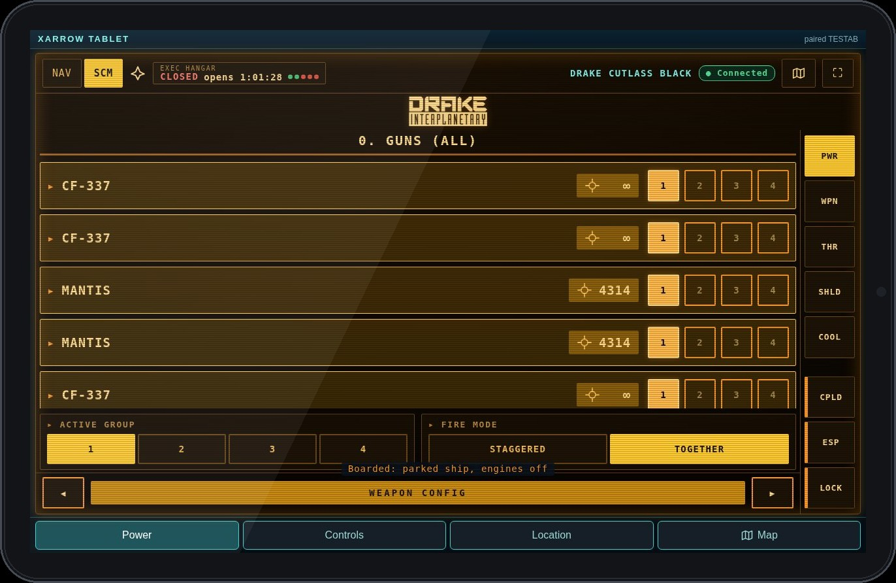</p>

**How it works:** the tablet only presses the keybinds you set in Star Citizen, so it knows what it sent, not what the game currently shows (unless you turn on the optional [game telemetry](#optional-live-game-telemetry-since-1125)). There's a small learning curve. Once you've matched it to your ship, it's quick.

1. **Board a ship.** The tablet switches to that ship by itself: the maker's look and logo, and that ship's power pip layout.
2. **Match the tablet to the cockpit.** Every ship starts with its own default power setup: how many pips go to weapons, engines and shields, and which systems are on or off (life support, coolers, quantum and so on). Look at the in-game power MFD, tap **MATCH**, set the tablet's columns to what you see (no keys are sent while you match), then tap **MATCH** again.
3. **Play from the tablet.** Once matched, every tap sends your keybind and the tablet stays in sync with the game. **SYNC** sets the game to exactly what the page shows, by driving each column to 0 and back up.
4. **Rules from the game still apply.** Quantum only powers up in NAV mode and shields power down in NAV, just like in the game.
5. **Usable pips.** The power column shows the pips your ship can really use (*left / usable*), not the raw power-plant output. Since 1.1.6 the usable pips per ship come from the [Star Citizen Wiki API](https://api.star-citizen.wiki) power data (`power_budget.v1.json`, CC BY-SA 4.0), so each ship gets its own total instead of the same number everywhere. If a ship looks off, tap the number to set it by hand for that ship.
6. **NAV / SCM.** With the Xparrow 3-key binds (*Set master mode NAV / SCM*), tapping **NAV** or **SCM** switches the game directly. Without those binds the chips only show the mode and send no key.
7. **Resync** resets power in the game (when *Reset power* has a 3-key bind) and puts the tablet back on that ship's default pips.

**Bind the actions first.** A button only works if its action is bound in the game. Unbound buttons stay greyed out. Go to **Options > Keybindings > Advanced Controls Customization**:

- **Flight - Power:** *Toggle Power - Weapons / Thrusters / Shields* (Thrusters = Engines on the tablet) and the pip controls.
- **Vehicles - Weapons:** *Weapon Presets - Set EMPs* (the **Set EMPs** button) and *Staggered Fire - On* / *Staggered Fire - Off* (the **Staggered / Together** button). Both are unbound by default.
- **Flight - Movement:** *Enable / Disable decoupled mode* (CPLD), *E.S.P. - Toggle On / Off* (ESP) and *Lock Pitch / Yaw Movement* (LOCK).

**Tips**

- **Match again** after a respawn, after you swap ships, or if you changed power with the keyboard or the in-game MFD. Without game telemetry the tablet can't see those changes; with it, on/off states correct themselves (pips still need MATCH).
- **LOCK** sends *Lock pitch / yaw*, the LOCK light on the in-game HUD. CPLD and ESP start lit (on) and LOCK starts unlit (off). Each one flips when its key is sent.
- Systems with no keybind in the game, like life support, radar and coolers, are "set here to match": they change on the tablet only.
- Which gun is in which group has no keybind either. Set it in the in-game Weapon Config, then tap the squares on the tablet to match.

### Optional: live game telemetry (since 1.1.25)

Star Citizen can share a read-only telemetry feed with programs on the same PC. It is off by default and Xparrow doesn't turn it on for you. To use it:

1. In Windows, add a **user** environment variable named `GRPC_CLIENT_SERVER_ENABLED` with the value `true` (Start > *Edit environment variables for your account* > New).
2. Fully close the RSI Launcher (tray icon too) and Star Citizen, then start them again.

With the feed on, the tablet shows a **TLM LIVE** dot in the header and:

- each system's real on/off state: weapons, engines, shields, coolers, life support and radar. Shields show OFFLINE when the game says they're off.
- the ten warning lights (PWR, WPN, THR, SHLD, COOL, QDRV, RADR, PROX, HIT, MISL) as a thin row of small lamps above the power columns.
- a **Flight instruments** page (tap the TLM dot, tap it again to go back, or use the arrows): speed, heading, radar altitude, G, boost, hydrogen fuel, quantum fuel when the game sends it, gear, landed, and the flight-assist lamps. The CPLD and ESP lamps follow the game.
- on Star Citizen 5.0, master mode (NAV / SCM) plus a damage panel with the shield faces, shield level, hull and a HIT lamp, when the game sends them. The game doesn't report damage per part.

The feed has no pip counts, so pips still follow the tablet's own model. It is display only: Xparrow never sends anything to the game through it. **TLM WAIT** means connected but not in a ship; **TLM OFF** means the feed isn't on (tap it for the steps).

### Tablet keybinds (3-key combos)

Since 1.1.5 every action the tablet presses or watches uses a **3-key keyboard combo** (for example *R Ctrl + R Shift + F1* for power on / off), so typing in game (map search, chat) can never trigger the tablet. If your `actionmaps.xml` doesn't have them yet, open **Settings & Keybinding > Save to game** and click **Apply Xparrow 3-key tablet binds**: your `actionmaps.xml` is backed up first, and it is only written while Star Citizen is closed. Xparrow never sends keys to set this up.

**PTU has its own keybinds.** Star Citizen keeps a separate `actionmaps.xml` for PTU. To use the tablet on PTU, open **Settings & Keybinding**, pick **PTU** at the top, go to **Save to game** and click **Apply Xparrow 3-key tablet binds** (with the game closed; a backup is made first). The tablet and the mission helper follow whichever build you started (the newest `Game.log`).

**All tablet binds are editable.** If one interferes with something, change it in Star Citizen's keybinding settings (or in Xparrow's Keybinding tab). The tablet always follows whatever your `actionmaps.xml` says. We recommend keeping them as combos of at least 3 keys.

## Backup & Restore

**Settings & Keybinding > About > App > Backup & Restore**

- **Back up** asks for a folder (Xparrow remembers your last choice) and saves a timestamped folder `Xparrow-backup-YYYY-MM-DD_HHMMSS` with your session plan (`plan-sync.json`), mission tracker (`mission-state.json`) and Xparrow's own settings.
- **Restore** picks a backup folder, asks you to confirm, keeps a safety copy of what it replaces, and then reloads.
- Game files are not part of the backup. Your `actionmaps.xml` backups stay in the Keybinding tab.

## Keeping locally customized files

If you edit one of Xparrow's own files in your data folder on purpose (for example a tweaked page or helper script), an app update would normally replace it with the new version. To keep your copy, create `_local_keep.json` in the data folder (the folder you picked during setup) with a list of paths relative to that folder:

```json
["overlay.html", "mission-helper/my-tweak.mjs"]
```

Files on that list are left alone by every update. They also stop getting fixes, so remove a line when you want the official version back. Game data, models and your settings are never replaced by app updates anyway.

## Troubleshooting

- **Weapons, Ship Loadout, Blueprints or Black Market show "failed to load" / 404:** you're on 1.1.6 or older. Install `Xparrow-Setup-1.1.27.exe` over it. The missing data is added and nothing is rebuilt.
- **Windows says "Windows protected your PC":** the app isn't code-signed. Click **More info > Run anyway** (see *Download*).
- **Setup says it can't find the game:** browse to the folder that contains `Data.p4k` (usually `...\StarCitizen\LIVE`).
- **Not enough disk space:** choose another drive in setup. Xparrow stops before a drive drops below its safety margin.
- **A ship shows "3D coming soon":** press *Load 3D from my game files* on that ship. If it fails, the stats and loadouts still work. Use *Report 3D issue* to save a local report in `%APPDATA%\Xparrow\3d_reports\` that you can share.
- **The tablet doesn't connect:** make sure the PC and tablet are on the same network, Xparrow is running (tray icon), and the firewall allows it on private networks.
- **A tablet button is greyed out:** bind that action in Star Citizen (Options > Keybindings), then reopen the tablet page.
- **After a game patch the data looks old:** Xparrow refreshes when it sees the new build. The game launcher must finish updating first.
- **The map is facing the wrong way:** press *Locate* on the Exploration map to realign it with your in-game position.
- **Setup stuck on step 2 / `EPERM` rename `status.json`:** fixed in 1.1.6. If it ever happens again:
  1. Close Xparrow fully: tray icon > **Quit**, then end any leftover *Xparrow* in Task Manager.
  2. In `<data drive>\Xparrow\data\update\`, delete only `status.json` and any `status.json.tmp-*` files.
  3. Start Xparrow again and press **Continue**. It resumes where it stopped.
  4. If it still loops, add the Xparrow data folder as an exclusion in your antivirus, and allow Xparrow in **Windows Security > Ransomware protection** (Controlled folder access).
- **Tablet in PTU:** PTU has its own keybinds. In Settings & Keybinding pick **PTU** at the top and apply the 3-key tablet binds there (game closed). The tablet follows the build you started.
- **Holding the master-mode button stopped switching NAV / SCM:** bind the tap actions *Cycle Master Mode* or *Set Master Mode NAV / SCM* in Star Citizen instead of the hold. With the Xparrow 3-key binds, tapping **NAV** or **SCM** on the tablet switches the game directly. The tablet notices a master-mode press within about 0.2 s.
- **Tablet pips look wrong for a ship:** tap **MATCH** and set the columns to what the cockpit shows, or **Resync** to reset power in the game and on the tablet.

## FAQ

### What Xparrow can do

- Show outfits, weapons and ships in 3D, with stats read from your own game files.
- Plan ship loadouts: swap guns and components, compare them, and see where to buy them.
- Compare your LIVE and PTU builds: what got buffed, nerfed or added, with a link to the official patch notes.
- Plan sessions, blueprints and crafting, Wikelo contracts and Black Market runs.
- Find hidden locations (wrecks, derelicts, caves, easter eggs) and plan the way there.
- Find loot near you: choose gear and rarity, set your search radius, and see the closest spots that can drop it.
- Track your missions and the blueprints they can drop, straight from `Game.log`.
- Plan your activities: missions, loot runs, blueprints and crafting in one session plan.
- Answer Star Citizen questions with Ask SC: lore, items, trade prices and PTU changes, offline and with sources.
- Let you test your joystick and fly a holographic ship through practice drills, using your own binds and curves.
- Drag and drop attachments onto weapons and components onto ships; in Weapons Compare an attachment dropped on one gun is fitted on both LIVE and PTU.
- Show a star map and your position from `/showlocation` (the game copies it to the clipboard) and from `Game.log`. Press *Locate* to place yourself and realign the map view with where you are in game.
- Run an always-on-top overlay while you play.
- Turn a tablet or phone into an MFD that presses the keys **you** bound in the game.
- Let you change every tablet bind yourself: in Star Citizen's keybinding settings or Xparrow's Keybinding tab. The tablet follows your `actionmaps.xml`; 3-key combos (the default since 1.1.5) are recommended so typing in game never triggers them.
- Build missing ship 3D models from your own game files, on demand.
- Use the tablet on LIVE and PTU: it follows the build you started, each with its own binds.
- Back up and restore your session plan, mission tracker and settings.

### What Xparrow can't do (and why)

- **No editing of aUEC, money, items or inventory.** Xparrow can't change anything on the game servers.
- **No memory reading or injection.** It never touches the running game process.
- **No changing game files.** The one exception is the MFD keybinds you approve in `actionmaps.xml`. Xparrow only writes those with the game closed, and it makes a backup first.
- **It can't press anything the game has no keybind for.** The tablet only sends keys that exist as game actions. *Staggered / Together* fire mode works because the game has actions for it (*Staggered fire on / off*).
- **MFD buttons only work when the matching action is bound in the game.** For example, *Set EMPs* needs *EMP preset* bound. Unbound buttons stay greyed out.
- **It can't read your pips from the game.** Star Citizen doesn't publish them (not even in its telemetry), so the tablet tracks what you press. Use MATCH or Resync when they drift. With the optional game telemetry on, on/off states, warning lights and flight data come from the game.
- **It doesn't copy your LIVE binds to PTU by itself.** You apply the tablet binds to PTU with one click, with the game closed.
- **It can't see live in-game state** beyond what `Game.log`, `/showlocation` and the optional game telemetry provide. Without telemetry, power, shield and fire-mode states on the tablet show what you pressed, not readings from the game.
- **It isn't affiliated with CIG.** It's a fan project.

### Q&A

**Is it safe and allowed?**
Xparrow only reads your game files and presses keys you bound yourself, like a keyboard macro pad. It doesn't read game memory, inject code or change server data. It's still a third-party tool, so you use it at your own risk.

**Why does it link my game folders?**
CIG's assets can't be redistributed, so Xparrow ships none. It reads them locally from your own install instead.

**Why is the first 3D load slow?**
Xparrow extracts the ship from your `Data.p4k` (more than 100 GB) and builds the model on your PC. That takes a few minutes per ship, at low priority in the background. After that, the model is cached.

**Does the tablet need the same Wi-Fi?**
Yes. The tablet connects to Xparrow on your PC over your local network, so both must be on the same network, and Windows Firewall must allow Xparrow on private networks.

## Changelog

### 1.1.27

- **In-app update prompt**: when a new version is found, a small Xparrow window says "New version available" with **Update** and **Later**. Update closes Xparrow (tray and helpers too), installs silently and opens Xparrow again by itself, with no extra prompts. Later keeps the normal install-when-you-close behaviour and asks again after a few hours and at the next start. It never appears while Star Citizen is running, and not in the portable build. The tablet also shows a small "update available" note.
- **NAV and SCM pips come back when you switch with your stick or key binds**: after a switch the tablet now ignores the game's late power report until the ship has answered, so it can no longer overwrite what it just restored. Weapons, engines, shields and quantum on/off are remembered per mode.
- **Tablet diagnostics stay on your PC**: the helper keeps a small local log of mode switches (tablet-diag.log in the helper folder, rotated at 1.5 MB). Nothing is sent anywhere and nothing is shown on screen.

### 1.1.26

- **NAV and SCM remember everything**: each master mode keeps its own pips, plus which of shields and quantum you turned off, and puts them back when you switch.
- **Turning the ship off and on keeps your pips**: power on, Flight ready and boarding no longer reset a ship that has a saved layout. Defaults only for a new ship or after Reset power (current mode only).
- **Shields and every column can go lower**: the floor is 1 pip (it used to be the sum of the generators' minimums, e.g. 2), and tapping or dragging to 0 turns the column off.
- **The tablet loads the newest MFD**: the tablet gateway sends the tablet scripts with no-cache.

### 1.1.25

- **NAV and SCM keep their own pips**: the tablet now stores a separate pip layout for each master mode, per ship, and swaps it when you switch NAV / SCM (display only, no pip keys). Power on resets both; Reset power resets the current mode.
- **Plan popup on the tablet**: tap the Plan area to see every item with its details, check marks and the next one, and tick or untick items (synced with the app).
- **Optional live game telemetry on the tablet**: with Star Citizen's read-only telemetry turned on (user environment variable `GRPC_CLIENT_SERVER_ENABLED=true`, then restart the RSI Launcher), the tablet shows a TLM LIVE dot, each system's real on/off state (shields show OFFLINE when the game says off), thin warning lamps and a Flight instruments page (speed, heading, radar altitude, G, boost, fuel, gear, landed, flight-assist lamps). On 5.0 it also follows master mode and shows a damage panel (shield faces, shield level, hull, HIT lamp) when sent. Pips keep the 1.1.24 model. Display only; Xparrow never turns the feed on for you.
- **Maker logos** for Argo, Banu, Gatac and Tumbril under the tablet header.
- **Fix**: the tablet top bar says XPARROW TABLET.

### 1.1.24

- **Tablet power pips start where the game starts them**: on power-on and Reset power the tablet uses the game's own default distribution (minimums, coolers at least half, weapons/engines/shields half their pool, the rest to radar; life support on).
- **Pip moves work like the game**: removing pips only frees them, adding needs free output, nothing is taken from coolers or other systems, and columns stop at the game minimum. With less output, weapons/engines/shields/radar are cut before coolers (game priority).
- **Resync and Sync only touch weapons, engines and shields**: no Reset power press, so coolers, life support and radar stay put. They wait for queued presses, lower all three first, then raise each from its real minimum.
- **About shows the version again**.

### 1.1.23

- **Tablet / MFD presses say "Not sent" when Windows blocks them**: if Star Citizen runs as administrator and Xparrow doesn't, Windows drops the keys without an error. Xparrow now checks first and the tablet says how to fix it (turn off "Run as administrator" for Star Citizen and the RSI Launcher, or run Xparrow as administrator too).
- **Key helper starts through the admin task when you have it**: with the "Xparrow Mission Helper (admin)" scheduled task, Xparrow starts the key helper through it and waits, instead of sometimes starting a normal copy first. An older key helper is closed once on the first start after the update.
- **Tablet pips move only after the game took the press**: pips, the output counter and power on/off change one confirmed press at a time; a refused press keeps the last confirmed value.

### 1.1.22

- **Outfit syncs with Xparrow Lite**: with Lite linked, the outfit on your character syncs both ways between the app and Lite's Outfits tab, last change wins (like the session plan).
- **Lite's map follows the app's map position**: your last /showlocation fix and route show in Lite even when the game is closed.

### 1.1.21

- **Link Xparrow Lite to the app.** In the **Settings & Keybinding** tab, **Link Xparrow Lite** shows a one-time 6-character code (2 minutes). Type it in Xparrow Lite under **Link to Xparrow app** and Lite's map follows your live position, your session plan syncs both ways, and tablet / MFD ship controls go through the app. Only Xparrow Lite with a valid key is accepted, and you can unlink any browser from the same window.
- **Inmate Worksuit is no longer a standalone suit**: armour goes on top of it. Flight suits and BUL-H4 stay standalone.
- **Blueprints data update fix**: ship-component blueprints get their real names and mission counts.

### 1.1.20

- **Fixed the Ship Loadout page going blank or freezing when switching 3D ship models.** A leftover or damaged model file could be loaded over and over until the 3D view crashed. Missing or bad models now show a clean placeholder, and the stats and loadout stay usable. Switching ships quickly cancels the previous load, and if the 3D view ever crashes the window reloads itself.

### 1.1.19

- **Fixed Xparrow closing by itself a few seconds after opening (a leftover update was being reinstalled).** Opening the app no longer silently quits to run an installer. Leftover or same-version update files are removed on startup, and a real newer update is installed when you close Xparrow (or when you choose Install, which shows the installer window).

### 1.1.18

- **Fixed a brief console window flash; background helpers now always run hidden.** The live-position helper is only restarted when it is actually down, and it is started directly rather than through a `.cmd` file. A release check fails the build if any helper would launch a visible console.

### 1.1.17

- **Live position works automatically** on every install, including when Star Citizen is on a custom path such as `E:\\RSI\\StarCitizen\\LIVE`. Xparrow finds `Game.log` itself, keeps the helper running, and the map follows you from the game's own log. If you type `/showlocation` in chat, the game copies the coordinates itself and the map updates. Settings has a last-resort folder picker if the game still can't be found.
- **Item pictures** now show on the Items cards even when an existing catalog is missing thumbnail paths, or when some thumbnail files were never copied to the data folder. On every launch, missing bundled files are copied (existing files are not overwritten), empty or broken `item.thumb` fields are filled when the matching picture is on disk, and the Items grid can fall back to `thumbs/sc/{id}.webp`.

### 1.1.16

- **Outfits loads again** on installs whose item list was built by an older updater (missing maker names and presets), instead of stopping with "Cannot read properties of undefined (reading 'SC-CLDA')". Missing optional data is handled safely, and the missing maker names, presets and ships are filled in from the bundled data on first launch (your catalog is backed up to `_backup` first; items are not changed).
- **The public tablet page** is refreshed with app updates on installs where it was being skipped.

### 1.1.15

- **Outfits no longer stays on "Loading 3D viewer…"** with an empty Items list when the catalog or optional gamedata takes too long, when presets are missing, or when an old kept main file was left behind after an upgrade. The item grid paints as soon as the catalog is accepted. If the catalog cannot be loaded, you get a clear message and **Try again**.
- **App updates land more reliably.** After an installer run, Xparrow waits for its bundled viewer before refreshing app code and logs the path it checked. `index.html` and `main-*.js` are always refreshed (unless they are a private keep). The version stamp is written only after a successful refresh. HTML, JSON and assets are served without being cached, and the HTTP cache is cleared after a code refresh.
- **Renderer errors** (console errors, unhandled rejections and failed requests) are written to `xparrow.log`, rate-limited and without personal data, so a stuck tab is easier to diagnose. DevTools stays off in packaged builds.

### 1.1.14

- **Updates install when it is safe:** Xparrow checks at start and every two hours, downloads quietly, and installs after about 10 minutes idle when Star Citizen is not running, or the next time you open the app. A small **Update ready, restart now** button is in the header. It will not interrupt you mid-game and will not close Star Citizen.
- **About** always shows the real running app version.
- **Kept local customizations** no longer freeze old app code. When a new version is newer than the version a kept file was made for, that file is refreshed. Private tablet files you kept locally are never overwritten and are never included in the app download.
- **Ship hangar backgrounds** are included, and ships in the 3D viewer still sit on the floor, with a more reliable landing-gear / gear-door check.

### 1.1.13

- **Weapons Compare attachments** now mount on both guns ? the live gun and the holographic PTU gun ? at the correct port.
- **Scan my devices** in Settings and Keybinding finds your joysticks and can apply My setup or Auto-detect.
- **Ships sit on the floor** in the 3D viewer.
- **Ship-model fixes:** the Avenger Stalker's ghost landing-gear mesh is dropped, guns on the Eclipse and the 890 Jump can be swapped in the loadout, and broken leftover parts and windows are cleaned up.
- **Existing ship models are re-checked automatically** in the background after this update. Originals are backed up first, and a model is only replaced when the check improves it.

### 1.1.12

- **Outfits on a new install** now loads the item list and filters from a catalog included in the installer. If that data is missing, you get a clear message and a **Try again** button instead of a spinner that never ends.
- **Outfit 3D models build automatically** after an update when your Star Citizen folder is already saved and those models are still missing or very few. No setup window; a small progress note appears on the Outfits page. The lighter path is used when free RAM is under 20 GB. Setup only appears if no game folder is saved yet.
- **Newly built ships** get an automatic model checklist, with a retry so weapon hardpoints can be swapped.
- **Ship-model fixes**, and **Rebuild 3D** and **Low detail** now sit with the other model buttons at the top right of the loadout page.
- **The desktop shortcut is kept** when the app updates itself.

### 1.1.11

- **Big ships like the Galaxy** now build on PCs with less memory: an automatic light build when free RAM is under 20 GB, an auto-retry if memory runs out, a **Low detail** button, and a clear message.

### 1.1.10

- **Missing 3D models** no longer show a blank view: Ship Loadout shows **Model missing — Rebuild 3D** and the **Load 3D from my game files** button.
- **Rebuild 3D** can force a re-export from your game files.
- **Fresh installs** no longer think ships have models they don't.

### 1.1.9

- **App files now refresh automatically** after an update, including installs where 1.1.8 left the old viewer in place. Nothing to copy by hand.
- **Ground-vehicle MFD switching** on the tablet.
- About shows the installed app version.

### 1.1.8

- **Outfits on a fresh install:** the installer now includes the mannequins, base body, undersuits and layering data, so Outfits loads on a new PC.
- **Weapon attachments** are rebuilt when they're missing after a fresh install or an update.
- **Map Ambush and Loot data** is kept if a rebuild comes back with less than half of it.
- **Game Mode starts Off** (and is gone from the tablet).
- **Exploration-suit armour rules** in the outfit builder.
- **New Tablet settings page.**
- **Wikilore logo** (the head) returns you to the Wikilore home screen with all posts.
- **Asset files are no longer cached for an hour**, so updates show up as soon as you reload.
- About shows 1.1.8.

### 1.1.7

- **Every tab works on a fresh install:** the installer now includes the weapons, ship loadout, blueprint, Black Market, exploration, Wikelo, reputation, PTU and icon data that setup doesn't build from the game files. A 1.1.6 install with empty pages only needs 1.1.7 installed over it.
- **Automatic updates** from GitHub Releases for the installed version (checks at start and every few hours, installs when you quit).
- **Game-data updates are sturdier:** a rebuild keeps ship presets, manufacturers and item grouping, the crafting check error is fixed, and the "rename dcb" error after a successful update is gone.
- **StarBreaker is always found:** the updater uses the copy that ships with Xparrow, and says clearly if it's missing instead of skipping 3D exports.
- **Weapon paint layers** (camo, blend maps, logo stencils) now build on every PC.
- **Keep locally customized files** across updates with `_local_keep.json`.
- About shows 1.1.7.

### 1.1.6

- **Setup loop fixed:** first-run setup could get stuck on step 2 with `EPERM` renaming `status.json` (antivirus or Controlled folder access holding the file). Writes now retry safely and setup resumes.
- **Tablet usable pips** per ship from the Star Citizen Wiki power data, so each ship shows its own total.
- **Absolute power and shield binds** and a **Resync** button on the tablet.
- **NAV / SCM chips** switch the game directly when the 3-key *Set master mode NAV / SCM* binds exist, and stay display-only otherwise.
- **Master mode** presses are noticed faster (every 0.2 s).
- **PTU support:** the tablet and mission helper follow the build you started; Settings & Keybinding can apply the 3-key tablet binds to PTU's `actionmaps.xml` (game closed, backup first, only when you click).
- **Backup & Restore** for your session plan, mission tracker and settings.
- Exploration map: linked maps and **Locate**.
- About shows 1.1.6.

### 1.1.5

- Weapons Compare rework, faster 3D redraw when switching tabs, 3-key tablet binds by default.

## Support

Xparrow is 100% free and always will be. If you'd like to say thanks, you can leave a one-off tip on [Ko-fi](https://ko-fi.com/blackxparrow). Totally optional.

## Credits and licences

Credits match the in-app **Settings & Keybinding > About** list.

- **ChrisGBG** — Star Citizen Reference Sheets (Wikelo sheet): Wikelo material amounts and where to find them.
- [SC CraftLab](https://sccraftlab.com/wikelo) (sccraftlab.com/wikelo): Wikelo trade locations.
- [Star Citizen Wiki](https://starcitizen.tools) (starcitizen.tools): pictures and descriptions, plus Black Market lab, drug and organisation data adapted from it (reformatted and merged into Xparrow's format). Licensed [CC BY-SA 4.0](https://creativecommons.org/licenses/by-sa/4.0/); the adapted data file (`viewer/updater/sources/static/bm_static.v1.json`) is shared under the same licence.
- **Dabalta** — “SC Alpha 4.8 FPS Data” sheet (private): Damage Viewer health values and armour-resistance cross-check. The calculator tab is not used.
- [Erkul](https://www.erkul.games) and [SPViewer](https://www.spviewer.eu) — published weapon and item stats used only as data to fill or cross-check the Damage Viewer fire-sim where the game-file extract is missing or less complete. Their code, UI and artwork are not used.
- [StoppingPower](https://stoppingpower.io) — public FPS `weapons.json`, used to audit weapons data. Game-file values are never overwritten from it.
- Erkul and SPViewer — also ship-gun / ship-performance cross-checks and Erkul Browse loadout pins, and the public SPViewer changelog. Private/session APIs were not called. Code, UI and artwork are not used.
- Community FPS and ship guides cited in presets: bustedloops, expcarry, r/starcitizen, MMOPIXEL.
- [Star Citizen Wiki API](https://api.star-citizen.wiki) — structured `personal_weapon` JSON used only to fill RPM and spread fields that were still class defaults after the game-file extract, and to record mismatches. Game-file values are never overwritten. Their site design and other media are not used.
- [Star Citizen Wiki API](https://api.star-citizen.wiki) — ship power data (`power.generation_segments`) used for the tablet's usable pips per ship (`power_budget.v1.json`), licensed [CC BY-SA 4.0](https://creativecommons.org/licenses/by-sa/4.0/). Thanks to the Star Citizen Wiki team.
- Game data comes from your own local Star Citizen install; trade prices are UEX community reports.
- 3D export uses **StarBreaker** (`starbreaker_msvc.exe`), MIT licence. Its licence and notice ship in `tools/starbreaker/` (LICENSE, NOTICE). Thanks to its authors.
- Built with Electron, Three.js, Vite and glTF-Transform. Their licences are included in the app.
- Music: provided by the Xparrow team.
- This is an unofficial Star Citizen fan project, not affiliated with the Cloud Imperium group of companies. All content not authored by its host or users is property of its respective owners. Official site: [robertsspaceindustries.com](https://robertsspaceindustries.com).

## Disclaimer

*This is an unofficial Star Citizen fan project, not affiliated with the Cloud Imperium group of companies. All content not authored by its host or users is property of its respective owners.* Official Star Citizen site: [robertsspaceindustries.com](https://robertsspaceindustries.com).

Xparrow is an unofficial fan project. It is **not affiliated with, endorsed by or sponsored by Cloud Imperium Games or Roberts Space Industries**. Star Citizen®, Squadron 42®, Roberts Space Industries® and Cloud Imperium® are trademarks of Cloud Imperium Rights LLC. Ship and maker names belong to their owners. No game assets are included in this project.
